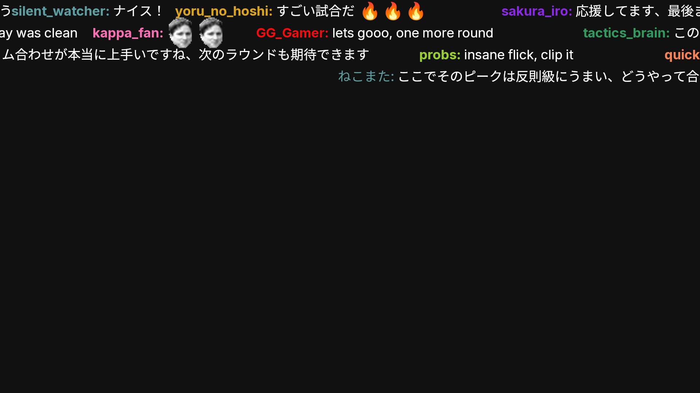

<div align="center">
  <a href="https://github.com/lay295/TwitchDownloader">
    
  </a>
  <h3 align="center">Twitch Downloader</h3>
  <div align="center">
    Twitch VOD/Clip/Chat Downloader and Chat Renderer
    <br />
    <br />
    <a href="https://github.com/lay295/TwitchDownloader/issues">Report Bug</a>
  </div>
</div>

This document is also available in:

- [**German / Deutsch**](README_de.md)]
- [**Italian / Italiano**](README_it.md)
- [**Japanese / 日本語**](README_ja.md)
- [**Portuguese (Brazil) / Português (Brasil)**](README_pt-br.md)
- [**Russian / Русский**](README_ru.md)
- [**Spanish / Español**](README_es.md)
- [**Turkish / Türkçe**](README_tr.md)
- [**Simplified Chinese / 简体中文**](README_zh-cn.md)
- [**Traditonal Chinese / 繁體中文**](README_zh-tw.md)
- [**French / Français**](README_fr.md)

## Danmaku Fork （このフォークについて）

This fork of TwitchDownloader adds **NicoNico-style flowing chat (danmaku) rendering**: instead of the
usual scrolling chat log, chat messages flow across the video from right to left.
通常のチャットレンダリングに加え、ニコニコ動画のようにコメントが右から左へ流れる
「弾幕」レンダリングを追加したフォークです。名前色・エモート（BTTV / FFZ / 7TV、動画エモート含む）・
バッジ・カラー絵文字に対応し、重ならないようレーン割り当てを行います。



### ダウンロード

[`danmaku-v*` の Releases](https://github.com/JamesBond000000-0/TwitchDownloader-Danmaku/releases) から
取得できます（GUI Windows 版〈ffmpeg 同梱〉、CLI Windows / Linux / Linux Arm64 版）。
ソースから使う場合は `danmaku` ブランチをチェックアウトしてください。

### GUI での使い方

1. Chat Render ページを開き、チャット JSON を読み込む
2. **Danmaku** タブで「Render as danmaku」にチェック
3. Render ボタン、または Task Queue 経由で実行（キューの Render Chat でも danmaku になります）

Danmaku タブの項目:

| 項目 | 説明 | 既定値 |
| --- | --- | --- |
| Scroll duration (sec) | 画面を横断する時間。速さの調整 | 6 |
| Speed mode | Uniform = 全コメント同速 / Fixed duration = 表示時間一定（長いコメントほど速い、ニコニコ式） | Uniform |
| Max lanes (0 = no limit) | 流すレーン数の上限。混雑時の間引き | 0 |
| Band opacity (0 = off) | 文字の背後に敷く半透明の帯（明るい映像での視認性向上） | 0 |
| Highlight badges | ハイライトするバッジ ID（カンマ区切り。例: vip,moderator,broadcaster,verified,partner） | 空 |
| Badge color | バッジ用ハイライト色。「Separate」にチェックした時だけ有効（未指定時は Highlight Users の色） | オフ |
| Highlight scale | ハイライトしたコメントだけの拡大率（1 = 通常サイズ） | 1 |
| GPU rendering (experimental) | コメント描画を GPU で行う（Skia GPU バックエンド）。使えない環境では自動で CPU 描画にフォールバック | オフ |
| Drop shadow | 文字に影を付ける | オフ |
| Hide usernames | ユーザー名を出さない | オフ |

キャンバスサイズ・フォント・背景色・出力形式 / コーデックは既存タブの設定がそのまま使われます。
Ignore Users / 禁止ワードは danmaku でも有効で、Highlight Users はコメントの背後に
ハイライト色の帯として表示されます。danmaku 設定は現状では保存されず、起動ごとに既定値に戻ります。

ハイライトはユーザー名だけでなく**バッジでも指定できます**（VIP やモデレーター、
認証済みユーザーなど）。バッジ持ちのコメントにも帯が付き、バッジ専用の色を分けることも
できます。両方に一致した場合はユーザー名指定の色が優先されます。なお Twitch の認証済みは
アーカイブのデータ形式によって `verified` と `partner` のどちらで入っていることもあるので、
確実に拾いたい場合は両方指定してください。

さらに、Danmaku タブの **「Per-badge colors...」** ボタンから、配信者・モデレーター・
VIP など**バッジごとに色**を付けられます（複数バッジ持ちの場合は一覧の上にある方が優先）。
**「Highlighted keep username」** にチェックすると、ユーザー名を消す設定でも
ハイライトしたコメントだけは名前が残ります。**Highlight scale** でハイライトした
コメントだけを大きく表示することもできます。

### GUI: プレビューで見ながら調整

Danmaku タブ下部の「Preview time (sec)」に時刻を入れて **Preview** ボタンを押すと、
現在の設定でその時刻の 1 フレームを描いたプレビューウィンドウが開きます。
プレビューを開いたままメインウィンドウで設定（速さ・レーン数・影/帯/輪郭・ハイライト等）を
変えて、プレビュー側の **Update** ボタンを押せば、その時点の設定で再描画されます。
本番レンダリングの前に見た目を確認・調整できます。

### GUI: Mass Downloader で一括 danmaku 化

チャンネルの動画をまとめて danmaku 化する場合は Mass Downloader 経由でもできます:

1. **先に** Chat Render ページで Danmaku タブの「Render as danmaku」にチェックし、
   キャンバスサイズや流れる速さなどを設定しておく（キュー投入時に、その時点の
   Render ページの設定がそのまま取り込まれるため）
2. Mass Downloader を開き、チャンネルのログイン名を入力して「Set Channel」
   （表示名や URL ではなくログイン名。失敗してもエラーは出ないので注意）
3. 一覧から処理したい動画をクリックして選択し、「Queue」ボタンを押す
4. Queue Options で「Download Chat」（形式は JSON）と「Render Chat」にチェックし、
   保存先フォルダを指定して OK
5. チャットのダウンロードが終わると、続けて danmaku レンダリングが自動で実行される。
   出力はチャット JSON と同じフォルダに、同名で拡張子が .mp4 のファイル

重複回避: 処理が成功した動画は「処理済みリスト」に記録され、次回から自動で
スキップされます（Queue Options の「Skip processed videos (dedup)」で ON/OFF、
スキップ時は件数が表示されます）。記録は動画 DL / チャット DL / レンダリングの
種類ごとに行われるので、「チャットだけ取得済み」の動画でも動画 DL はブロックされず、
不足分だけがキューに入ります。リストはテキストファイルで、保存先は設定画面や
Queue Options で変更できます。形式は CLI の `massrender` の state ファイルと共通なので、
同じファイルを指定すれば CLI と GUI で処理済みを共有できます。
この重複回避は Mass Downloader からの一括投入だけでなく、**各ダウンロードページ
（VOD / クリップ / チャット）や Chat Render ページからの単発投入でも効きます**
（いずれも Queue Options を経由するため）。チャットが取得済みでレンダリングだけ
必要な場合は、レンダリングだけがキューに入ります。

### GUI: 複数チャンネルとお気に入り (Mass Downloader)

- チャンネル欄にログイン名を**カンマ区切りで複数**入力すると、全チャンネルの
  動画（またはクリップ）を1つの一覧にまとめて表示します。各行には配信者名が
  付きます。複数チャンネル時は各チャンネルの先頭ページ（表示件数ぶん）までで、
  ページ送りは無効になります。存在しないチャンネルは名前を挙げて知らせます
- **☆ボタン**でお気に入りの登録/解除ができます。入力欄のログイン名（カンマ区切りで
  一括指定可）のうち、未登録のものは検証して追加、登録済みのものは解除されます
- お気に入りはチャンネル欄のドロップダウン先頭に「★ ログイン名」で常駐し、
  **クリックするだけでそのチャンネルの一覧まで一気に表示**されます

### CLI での使い方

```bash
# チャット JSON から流れるコメント動画を生成
TwitchDownloaderCLI danmakurender -i chat.json -o out.mp4 --video --start 1740 --length 120

# 元動画に直接合成（単一パス）
TwitchDownloaderCLI danmakurender -i chat.json -o out.mp4 --video --base-video vod.mp4 --base-start 1740 --length 60

# 1 フレームだけ PNG で確認
TwitchDownloaderCLI danmakurender -i chat.json -o frame.png --time 1800
```

主なオプション: `--duration`（横断秒数）、`--speed-mode uniform|fixed`、`--max-lanes`、
`--shadow` / `--band <0..1>` / `--outline`（視認性対策）、`--show-name`（名前表示）、
`--offset`（時刻シフト）、`-w` / `-h` / `--font-size`、`--collision`。
ハイライト: `--highlight-users <名前,名前>`、`--highlight-badges <バッジID,バッジID>`、
`--highlight-user-color <#AARRGGBB>`、`--highlight-badge-color <#AARRGGBB>`
（バッジ用を省略するとユーザー用の色。書式は `#RRGGBB` でも可）。
バッジごとの色は `--highlight-badge-colors <バッジID:#AARRGGBB,...>`
（書いた順が優先順位。そのバッジは `--highlight-badges` なしでもハイライトされます）。
`--highlight-show-name` は名前を消す設定（`--show-name false`）でもハイライトした
コメントだけ名前を残し、`--highlight-scale <倍率>` はハイライトしたコメントだけを
拡大します（どちらも danmaku 用）。
描画の GPU 化は `--gpu`（実験的。GPU が使えない環境では CPU 描画に自動フォールバックします）。
混みすぎてレーンに入らなかったコメントは間引かれ、件数がログに表示されます。

### CLI 一括処理 (massrender、`mass-cli` ブランチ)

指定ユーザーの動画をまとめて「チャット取得 → danmaku レンダリング」する CLI 機能です
（この機能は `mass-cli` ブランチにあります）。

```bash
# 新しいものを最大5本まで処理
TwitchDownloaderCLI massrender -u mrtenzouez -o ./out

# 対象の確認だけ（ダウンロード・レンダリングしない）
TwitchDownloaderCLI massrender -u mrtenzouez -o ./out --dry-run --limit 10
```

- 出力は `<output>/<動画ID>/` ごとにチャット JSON と `<動画ID>_danmaku.mp4`
- **重複回避**: 成功した動画 ID を state ファイル（既定は `<output>/mass-state.txt`、
  1行1件のテキスト）に記録し、次回以降はスキップします。失敗した動画は記録されず、
  次回リトライされます
- `--type ARCHIVE|HIGHLIGHT|UPLOAD` で動画種別の絞り込み、`--limit` で1回の処理本数を指定
- `--state <パス>` で記録ファイルの保存先を変更可能（例: `--state ~/done.txt`。
  出力フォルダとは別の場所に置いて使い回す、など）

詳細は [docs/mass-render.md](docs/mass-render.md) を参照してください。

詳細な設計メモは [docs/danmaku-design.md](docs/danmaku-design.md) を参照してください。

### クレジット (Credits)

- **ニコニコ動画**（株式会社ドワンゴ）— 画面を右から左へ流れるコメント「弾幕 (danmaku)」の
  発祥であり、本機能の様式の参考元です
- **[lay295/TwitchDownloader](https://github.com/lay295/TwitchDownloader)** — 本フォークの
  ベースソフトウェア。danmaku の描画はその ChatRenderer の仕組み（エモート・バッジ・
  名前色などの処理）を土台に実装しています
- **Saccubus** — ニコニコのコメントを動画へ描画する先行ツール。本フォークの着想の
  出発点になりました

---

## What Can It Do?

- Download Twitch VODs
- Download Twitch Clips
- Download chat for VODs and Clips, in either a [JSON with all the original information](https://github.com/lay295/TwitchDownloader/files/13495494/ExampleMoonMoonJsonFile.json), a browser HTML file, or a [plain text file](https://github.com/lay295/TwitchDownloader/files/13495523/ExampleMoonMoonTextFile.txt)
- Update the contents of a previously generated JSON chat file with an option to save as another format
- Use a previously generated JSON chat file to render the chat with Twitter Twemoji or Google Noto Color emojis and BTTV, FFZ, 7TV static and animated emotes

### Chat Render Example

<https://user-images.githubusercontent.com/1060681/197653099-c3fd12c2-f03a-4580-84e4-63ce3f36be8d.mp4>

# GUI

## Windows WPF


### [See the full WPF documentation here](TwitchDownloaderWPF/README.md)

### Functionality

The Windows WPF GUI implements all of the main functions of the program along with some extra quality of life functions:

- Queue up multiple download/render jobs to run simultaneously
- Create a list of download jobs from a list of vod/clip links
- Search for and download multiple VODs/clips from any streamer without leaving the app

### Multi-language Support

The Windows WPF GUI is available in multiple languages thanks to community translations. See the [Localization section](TwitchDownloaderWPF/README.md#localization) of the [WPF README](TwitchDownloaderWPF/README.md) for more details.

### Theming

The Windows WPF GUI comes bundled with both light and dark themes, along with an option to update live according the current Windows theme. It also supports user created themes! See the [Theming section](TwitchDownloaderWPF/README.md#theming) of the [WPF README](TwitchDownloaderWPF/README.md) for more details.

### Video Demonstration

<https://www.youtube.com/watch?v=0W3MhfhnYjk>
(older version, same concept)

## Linux?

Check twitch-downloader-gui on [github](https://github.com/mohad12211/twitch-downloader-gui) or on the [AUR](https://aur.archlinux.org/packages/twitch-downloader-gui) for a Linux GUI wrapper for the CLI.

## MacOS?

No GUI is available for MacOS yet :(

# CLI

### [See the full CLI documentation here](TwitchDownloaderCLI/README.md)

The CLI is cross-platform and implements the main functions of the program. It works on Windows, Linux, and MacOS<sup>*</sup>.

<sup>*Only Intel Macs have been tested</sup>

With the CLI, it is possible to automate video processing using external scripts. For example, you could copy-paste the following code into a `.bat` file on Windows to download a VOD and its chat, and then render the chat, all from a single input.

```bat
@echo off
set /p vodid="Enter VOD ID: "
TwitchDownloaderCLI.exe videodownload --id %vodid% --ffmpeg-path "ffmpeg.exe" -o %vodid%.mp4
TwitchDownloaderCLI.exe chatdownload --id %vodid% -o %vodid%_chat.json -E
TwitchDownloaderCLI.exe chatrender -i %vodid%_chat.json -h 1080 -w 422 --framerate 30 --update-rate 0 --font-size 18 -o %vodid%_chat.mp4
```

## Windows - Getting started

1. Go to [Releases](https://github.com/lay295/TwitchDownloader/releases/) and download the latest version for Windows or [build from source](#building-from-source).
2. Extract `TwitchDownloaderCLI.exe`.
3. Browse to where you extracted the executable:

```
cd C:\folder\containing\TwitchDownloaderCLI
```

4. If you do not have FFmpeg, you can install it via [Chocolatey package manager](https://community.chocolatey.org/), or you can get it as a standalone file from [ffmpeg.org](https://ffmpeg.org/download.html) or by using TwitchDownloaderCLI:

```
TwitchDownloaderCLI.exe ffmpeg --download
```

5. You can now start using TwitchDownloaderCLI, for example:

```
TwitchDownloaderCLI.exe videodownload --id <vod-id-here> -o out.mp4
```

You can find more example commands in the [CLI README](TwitchDownloaderCLI/README.md#example-commands).

## Linux – Getting started

1. Some distros, like Linux Alpine, lack fonts for some languages (Arabic, Persian, Thai, etc.) If this is the case for you, install additional fonts families such as [Noto](https://fonts.google.com/noto/specimen/Noto+Sans) or check your distro's wiki page on fonts as it may have an install command for this specific scenario, such as the [Linux Alpine](https://wiki.alpinelinux.org/wiki/Fonts) font page.
2. Ensure both `fontconfig` and `libfontconfig1` are installed. `apt-get install fontconfig libfontconfig1` on Ubuntu.
3. Go to [Releases](https://github.com/lay295/TwitchDownloader/releases/) and download the latest binary for Linux, grab the [AUR Package](https://aur.archlinux.org/packages/twitch-downloader-bin/) for Arch Linux, or [build from source](#building-from-source).
4. Extract `TwitchDownloaderCLI`.
5. Browse to where you extracted the binary:

```
cd directory/containing/TwitchDownloaderCLI
```

6. Give the binary executable rights:

```
sudo chmod +x TwitchDownloaderCLI
```

7. a) If you do not have FFmpeg, you should install it system-wide via your distro package manager, however you can also get it as a standalone file from [ffmpeg.org](https://ffmpeg.org/download.html) or by using TwitchDownloaderCLI:

```
./TwitchDownloaderCLI ffmpeg --download
```

7. b) If downloaded as a standalone file, you must also give it executable rights with:

```
sudo chmod +x ffmpeg
```

8. You can now start using TwitchDownloaderCLI, for example:

```
./TwitchDownloaderCLI videodownload --id <vod-id-here> -o out.mp4
```

You can find more example commands in the [CLI README](TwitchDownloaderCLI/README.md#example-commands).

## MacOS – Getting started

1. If your device has an Apple Silicon M-series processor, ensure that you download the arm64 binary, however if you would like to use the x64 binary on Apple Silicon it must be run via a terminal session running under Rosetta 2:

```
arch -x86_64 zsh
```

2. Go to [Releases](https://github.com/lay295/TwitchDownloader/releases/) and download the latest binary for MacOS or [build from source](#building-from-source).
3. Extract `TwitchDownloaderCLI`.
4. Browse to where you extracted the binary:

```
cd directory/containing/TwitchDownloaderCLI
```

5. Give the binary executable rights in the terminal:

```
chmod +x TwitchDownloaderCLI
```

6. a) If you do not have FFmpeg, you can install it system-wide via the [Homebrew package manager](https://brew.sh/), or you can get it as a standalone file from [ffmpeg.org](https://ffmpeg.org/download.html) or by using TwitchDownloaderCLI:

```
./TwitchDownloaderCLI ffmpeg --download
```

6. b) If downloaded as a standalone file, you must also give it executable rights with:

```
chmod +x ffmpeg
```

7. You can now start using TwitchDownloaderCLI, for example:

```
./TwitchDownloaderCLI videodownload --id <vod-id-here> -o out.mp4
```

You can find more example commands in the [CLI README](TwitchDownloaderCLI/README.md#example-commands).

# Building from source

## Requirements

- [.NET 10.0.x SDK](https://dotnet.microsoft.com/en-us/download/dotnet/10.0)
- About 1GB of disk space

## Build Instructions

1. Clone the repository:

```
git clone https://github.com/lay295/TwitchDownloader.git
```

2. Navigate to the solution folder:

```
cd TwitchDownloader
```

3. Restore the solution:

```
dotnet restore
```

- Non-Windows devices may need to explicitly specify a project to restore, i.e. `dotnet restore TwitchDownloaderCLI`

4. a) Build the GUI:

```
dotnet publish TwitchDownloaderWPF -p:PublishProfile=Windows
```

4. b) Build the CLI:

```
dotnet publish TwitchDownloaderCLI -p:PublishProfile=<Profile>
```

- Applicable Profiles: `Windows`, `Linux`, `LinuxAlpine`, `LinuxArm`, `LinuxArm64`, `MacOS`, `MacOSArm64`

5. a) Navigate to the GUI build folder:

```
cd TwitchDownloaderWPF/bin/Release/net10.0-windows/publish/win-x64
```

5. b) Navigate to the CLI build folder:

```
cd TwitchDownloaderCLI/bin/Release/net10.0/publish
```

# Third Party Credits

Chat Renders are rendered with [SkiaSharp](https://github.com/mono/SkiaSharp) and [HarfBuzzSharp](https://github.com/mono/SkiaSharp) © Microsoft Corporation.

Chat Renders are encoded and Video Downloads are finalized with [FFmpeg](https://ffmpeg.org/) © The FFmpeg developers.

Chat Renders may use [Noto Color Emoji](https://github.com/googlefonts/noto-emoji) © Google and contributors.

Chat Renders may use [Twemoji](https://github.com/jdecked/twemoji) © Twitter and contributors.

Bundled FFmpeg binaries are fetched from [gyan.dev](https://www.gyan.dev/ffmpeg/) © Gyan Doshi.

FFmpeg binaries fetched are runtime are downloaded using [Xabe.FFmpeg.Downloader](https://github.com/tomaszzmuda/Xabe.FFmpeg) © Xabe.

Chat HTML exports utilize the _Inter_ typeface hosted by the [Google Fonts API](https://fonts.google.com/) © Google.

For a full list of utilized external libraries, see [THIRD-PARTY-LICENSES.txt](./TwitchDownloaderCore/Resources/THIRD-PARTY-LICENSES.txt).

# License

[MIT](./LICENSE.txt)

TwitchDownloader is in no way associated with Twitch Interactive, Inc. or its affiliates.
